# Starter Island — curriculum and mission framework

OneRoboLab · World 1 · 24 missions + optional 17-A

**Status (2026-10-06):** all 24 missions are built on the framework (17-A, the optional leaderboard challenge, is still planned). Every mission has a reference solution that passes on every layout, plus a test that a naive program fails (`features/levels/levels.test.ts`, `reference-solutions.ts`).

---

## 1. Curriculum architecture

**Story.** After a storm, Starter Island's smart infrastructure is down: bridges, traffic systems, warehouses, energy stations, rescue stations and transport routes. The student is a Junior Robotics Engineer, and every mission repairs one system. On the adventure map, the repaired parts light up along the road. By the Arena, the student programs an autonomous rescue robot in Python.

The guiding arc moves the student from *"tell the robot exactly what to do"* to *"tell the robot how to think"*.

| Stage | Levels | Editor | Thinking mode | Map region (existing stops) |
|---|---|---|---|---|
| A · Robot basics | 1–6 | Blocks | Exact instructions: sequence, timing, ordered goals | Launch Pad, Training Zone, Grassland, Forest |
| B · Robots meet the world | 7–12 | Blocks | Reactive: sensors, `if`, loops, feedback | Forest, River Crossing |
| C · Gate 2 → Python bridge | 13–15 | Blocks + Python preview, then side-by-side | Combining sensors, variables, boolean logic | Gate 2 (Sensor Challenges), Robot Facility |
| D · Python robotics | 16–23 (+17-A) | Python first (blocks stay available) | Algorithms: `while`, `break`, functions, coordinates, optimisation | Facility, Canyon Pass, Research Outpost |
| E · Arena | 24 | Python only | Autonomous behaviour under pressure | Arena Gate, Final Arena |

**Difficulty tiers** (`MissionBriefing.tier`) work as follows:

- **Easy:** one objective and one new concept.
- **Medium:** a primary and a secondary objective, with 1–2 new concepts.
- **Hard:** several objectives, sensor feedback and optimisation.
- **Boss:** several concepts combined, a dynamic environment and more than one valid algorithm.

| # | Mission | Tier | Repairs | New mechanic |
|---|---|---|---|---|
| 1 | First Delivery | Easy | Supply chain | Cargo, stop-in-zone ✔ built |
| 2 | Power Station | Easy | Energy | Waypoints / multi-turn route ✔ built |
| 3 | Supply Run | Easy | Supply chain | Planned obstacle avoidance ✔ built |
| 4 | Build the Bridge | Medium | Bridge | **Pushable objects, construction zone, counter 0/3** ✔ built |
| 5 | Traffic Crossing | Medium | Traffic | **Timed traffic lights**, `wait` ✔ built |
| 6 | Rescue Route | Medium | Rescue | **Ordered checkpoints** ✔ built |
| 7 | Broken Bridge | Medium | Bridge | Blocked route → first `if obstacle` ✔ built |
| 8 | Cargo Station | Medium | Warehouse | **Pickup / drop**, `repeat` ✔ built |
| 9 | Color Warehouse | Medium | Warehouse | Colour sensor, colour-coded cargo ✔ built |
| 10 | Smart Gate | Medium | Gate | **Distance-triggered gate** ✔ built |
| 11 | Traffic Controller | Hard | Traffic | Signal states → `if / else if / else`, speed control ✔ built |
| 12 | Line Rescue | Hard | Rescue | Line sensor feedback loop ✔ built |
| 13 | Gate 2 · Sensor Challenge | Boss | Gate 2 | **Randomised layout on reset** ✔ built |
| 14 | Flooded Village | Hard | Village | **Hazard zones** (no-go areas) ✔ built |
| 15 | Bridge Engineer | Hard | Bridge | **Variable bridge length per run**, Blocks ⇄ Python side-by-side ✔ built |
| 16 | Emergency Dispatcher | Hard | Rescue | **Mission parameters** (`target = "C"`), Python editor ✔ built |
| 17 | Rescue Collector | Hard | Rescue | Collect-and-return, `for` / `while` ✔ built |
| 17-A | Hidden Treasure | Optional | Energy core | **Leaderboard**, efficiency score |
| 18 | Smart Parking | Hard | Parking | **Bay occupancy**, `while` + `break` ✔ built |
| 19 | Delivery Network | Hard | Logistics | **Coordinates API** ✔ built |
| 20 | Storm Evacuation | Hard | Villages | **Data records** (risk, people) → compound conditions ✔ built |
| 21 | Robot Factory | Hard | Factory | Functions, `for` × 10 ✔ built |
| 22 | Autonomous Explorer | Boss | Outpost | **Fog / partial map**, sensor-driven exploration ✔ built |
| 23 | Island Recovery | Boss | All systems | Multi-system mission, multiple solutions ✔ built |
| 24 | Arena · Smart Island Rescue | Boss | Everything | Dynamic obstacles, time pressure, bonus objectives, ranks ✔ built |

---

## 2. Level dependency graph

```mermaid
flowchart LR
  L1[1 First Delivery] --> L2[2 Power Station] --> L3[3 Supply Run] --> L4[4 Build the Bridge] --> L5[5 Traffic Crossing] --> L6[6 Rescue Route]
  L6 --> CP1{{Checkpoint 1}} --> L7[7 Broken Bridge] --> L8[8 Cargo Station] --> L9[9 Color Warehouse] --> L10[10 Smart Gate] --> L11[11 Traffic Controller] --> L12[12 Line Rescue]
  L12 --> G2{{Gate 2}} --> L13[13 Sensor Challenge] --> L14[14 Flooded Village] --> L15[15 Bridge Engineer]
  L15 --> L16[16 Emergency Dispatcher] --> L17[17 Rescue Collector] --> L18[18 Smart Parking]
  L17 -. optional .-> L17A[17-A Hidden Treasure]
  L18 --> CP3{{Checkpoint 3}} --> L19[19 Delivery Network] --> L20[20 Storm Evacuation] --> L21[21 Robot Factory] --> L22[22 Autonomous Explorer] --> L23[23 Island Recovery]
  L23 --> G4{{Arena Gate}} --> L24[24 Smart Island Rescue]
  L24 --> W2[[World 2 · Canyon Circuit]]
```



- Unlocking is linear: level *N* needs *N − 1* (`level_prerequisites`).
- The gates are teaching checkpoints. Gate 2 (L13) tests stage B, and the Arena Gate (L24) tests everything.
- 17-A never blocks progress.
- Canyon Circuit opens when the whole world is complete. This is the existing `WORLD_COMPLETED` rule.

---

## 3. Skill progression map

Legend: **N** = new in this level, r = reused.

| Skill | 1 | 2 | 3 | 4 | 5 | 6 | 7 | 8 | 9 | 10 | 11 | 12 | 13 | 14 | 15 | 16 | 17 | 18 | 19 | 20 | 21 | 22 | 23 | 24 |
|---|---|---|---|---|---|---|---|---|---|---|---|---|---|---|---|---|---|---|---|---|---|---|---|---|
| Sequence / move / turn / stop | **N** | r | r | r | r | r | r | r | r | r | r | r | r | r | r | r | r | r | r | r | r | r | r | r |
| Route planning, waypoints | | **N** | r | r | | r | r | | | | | | r | r | | | | | r | | | | r | r |
| Interact: push, construction zone | | | | **N** | | | | | | | | | | | | | | | | | | | r | r |
| Timing (`wait`) | | | | | **N** | | | | | | r | | | | | | | | | | | | | r |
| Ordered objectives | | | | | | **N** | | | | | | | r | | | r | r | | | r | | | r | r |
| `if` | | | | | | | **N** | r | r | r | r | r | r | r | | r | r | r | r | r | r | r | r | r |
| `repeat` / `for` | | | | | | | | **N** | r | | | r | r | | r | | r | | | | r | | r | r |
| Pickup / drop | | | | | | | | **N** | r | | | | | | | | r | | | | r | | r | r |
| Colour sensor | | | | | | | | | **N** | | r | | r | r | | | | | | | | | r | r |
| Distance sensor, thresholds | | | | | | | | | | **N** | | | r | r | | | | r | | | | r | r | r |
| `if / else if / else` | | | | | | | | | | | **N** | r | r | r | | r | | | | r | | r | r | r |
| Line sensor, feedback loop | | | | | | | | | | | | **N** | r | | | | | | | | | r | r | r |
| Combining sensors | | | | | | | | | | | | | **N** | r | | | | r | | | | r | r | r |
| Variables, operators | | | | | | | | | | | | | | | **N** | r | r | r | r | r | r | r | r | r |
| Boolean logic (`and/or/not`) | | | | | | | | | | | | | **N** | r | r | | | r | | r | | r | r | r |
| Python syntax | | | | | | | | | | | | | | | preview | **N** | r | r | r | r | r | r | r | r |
| `while`, `break` | | | | | | | | | | | | | | | | | **N** | **N** | r | r | | r | r | r |
| Coordinates, distance reasoning | | | | | | | | | | | | | | | | | | | **N** | r | | | r | r |
| Compound conditions | | | | | | | | | | | | | | | | | | | | **N** | | r | r | r |
| Functions | | | | | | | | | | | | | | | | | | | | | **N** | r | r | r |
| Exploration algorithm | | | | | | | | | | | | | | | | | | | | | | **N** | r | r |
| Optimisation | | | | | | | | | | | | | | | | | 17-A | | | | | | **N** | r |

---

## 4. Sensor progression

| Sensor | Rover hardware | Introduced | Block / Python | First use → later use |
|---|---|---|---|---|
| None (dead reckoning) | — | L1–6 | — | The robot does exactly what it is told. Measured routes |
| Front proximity (obstacle) | distance ≤ 20 cm | L7 | `obstacle ahead?` / `robot.obstacle_ahead()` | Detect a blocked bridge → choose another route |
| Colour sensor | floor, 7.5 cm ahead of the wheels | L9 | `colour is …?` / `robot.color()` | Match cargo to its warehouse → signal tiles (L11), gates (L13) |
| Distance sensor | front ray, 2 m range | L10 | `distance` / `robot.distance()` | Stop at a threshold (gate) → parking (L18), exploration (L22) |
| Line sensor | floor, 12 cm ahead | L12 | `line detected?` / `robot.on_line()` | Follow a road line → combined in L13, L22, L24 |
| Battery (planned) | — | L17 | `robot.battery()` | Energy-aware routes in L17-A, L23, L24 |
| Touch / bumper | exists (`sensor.value` touch) | optional | `robot.bumped()` | Fallback for younger students |

The UI sensor panel (bottom-left Telemetry) shows distance, colour / line, heading and time today. Battery is added when the energy system lands.

---

## 5. Blockly → Python transition map

| Phase | Levels | Editor | What the student sees |
|---|---|---|---|
| Blocks only | 1–12 | Blocks (Python tab read-only) | The Python tab already shows the generated code, without emphasis |
| Python glimpse | 13–14 | Blocks + highlighted Python | The active block highlights its Python line while the program runs |
| Side-by-side | **15** | `BLOCKS │ PYTHON` split | Every block maps to one Python line. Editing the blocks updates Python live |
| Python first | 16–23 | Python editor, blocks optional | Replay earlier missions in Python, with hints in Python |
| Python only | 24 | Python | Blocks are hidden |

| Block | Python (the `onerobolab` module, a safe subset compiled to the same IR — never `eval`) |
|---|---|
| move forward *cm* | `robot.move_forward(cm)` |
| move backward *cm* | `robot.move_backward(cm)` |
| turn left / right *deg* | `robot.turn_left(deg)` / `robot.turn_right(deg)` |
| stop | `robot.stop()` |
| set speed *%* | `robot.set_speed(percent)` |
| wait *s* | `robot.wait(seconds)` |
| repeat *n* | `for i in range(n):` |
| repeat forever | `while True:` |
| if / if-else | `if …:` / `else:` (`elif` from L11) |
| obstacle ahead? / distance / colour is … / line detected? | `robot.obstacle_ahead()` / `robot.distance()` / `robot.color() == "red"` / `robot.on_line()` |
| set / change / get variable | `x = 5` / `x += 1` / `x` |
| compare, and / or / not | `<`, `>`, `==`, `and`, `or`, `not` |
| (L16+) mission data | `mission.target`, `mission.villages`, `mission.bays` |
| (L19+) position | `robot.position()` → `(x, y)`, `robot.go_to(x, y)` (L23+) |
| (L21+) functions | `def deliver(): …` |

Today the Python view is generated, read-only, from the block graph (`generators/python-generator.ts`). The Python editor is a new compiler front-end: Python subset → the existing IR. It is listed in §7.

---

## 6. Mission mechanics list

Each mechanic is a reusable system that a level switches on by name (`MissionBriefing.mechanics`) or by map entities. No level ships its own code.

| Mechanic | Used in | Status |
|---|---|---|
| Measured route with kerbs (leaving the route = collision) | 1–6, … | ✔ `corridorWalls` |
| **Stop inside a zone** | 1, 2, 10, 18 | ✔ `MissionDefinition.stopInFinish` |
| **Cargo carried + delivered (visual)** | 1, 3, 8 | ✔ `mechanics: ['cargo']` |
| Checkpoints | all | ✔ |
| Ordered checkpoints | 6, 16, 23 | ✔ `orderedCheckpoints` (skipping ahead fails) |
| Static obstacles | 3, 7 | ✔ |
| Pushable objects + construction zone + counter (0/3) | 4, 23 | ✔ `CollisionWorld.resolvePushes`, `pushToZone` objective with progress |
| Traffic lights with timed cycles | 5, 11, 23, 24 | ✔ `trafficLight` entity, `signalPhase`, live signal tile for the colour sensor, red-light rule |
| Blocked route / alternate path | 7, 13, 14 | ✔ map layout |
| Pickup / drop actions | 8, 17, 21, 23, 24 | ✔ `pick` / `drop` statements, `cargo` stacks, `WorldObjects` |
| Colour-coded cargo → matching warehouse | 9, 21 | ✔ crate colours, coloured delivery zones, wrong-delivery rule |
| Smart gate opening at a distance | 10, 15 | ✔ `gate` entity: opens after the robot rests on its scanner |
| Line roads | 12, 22, 24 | ✔ `guideLine` |
| Randomised layout on reset | 7, 9, 10, 13–22, 24 | ✔ `LevelDefinition.variants`, picked on load and every Reset |
| Hazard zones (fail on enter) | 13, 14, 16, 20, 23 | ✔ `zone` kind `hazard` |
| Variable parameters per run | 15–17, 19, 20 | ✔ `LevelDefinition.data` + `mission.value` block / `mission.key` |
| Bay occupancy | 18 | ✔ variants + distance sensor + `break` |
| Coordinates | 19, 23 | ✔ `robot.x()` / `robot.y()`, `go to x, y` |
| Fog / partial map | 22 | ✔ `fog`: minimap reveals explored cells, chase camera only, thick fog |
| Bonus objectives (optional, scored) | 23, 24 | ✔ `optional` objectives, `bonusPoints` (browser + server) |
| Leaderboard | 17-A | ✗ planned (API: best score per student per level, class board) |
| Time pressure | 13, 15, 24 | ✔ `timeLimit` |

---

## 7. Required simulator systems

| System | Status | Where |
|---|---|---|
| Fixed-step runtime, compiler, block editor | ✔ | `SimulationRuntime`, `compiler/` |
| Mission tracker with stop-in-zone rule | ✔ | `packages/mission-engine` |
| Scoring engine: completion, checkpoints, time, efficiency, collisions, ranks | ✔ | `packages/scoring-engine` (browser) = `apps/api/src/domain/scoring.ts` `pointsFor` (server verdict) |
| Mission briefing (BRIEFING → PREDICT) | ✔ | `MissionBriefingPanel` |
| Live HUD: objectives, timer, points, rank | ✔ | `MissionStatusBar` |
| Four-tier hints | ✔ | `features/levels/hint-tiers.ts`; the last tier is paid on the server |
| Failing block highlighted | ✔ | `errorBlockId` on collision / runtime error |
| Specific failure messages (collision, left route, stopped outside zone, timeout) | ✔ / partial | `SimulationDriver` |
| Success screen with server stars/XP + points breakdown | ✔ | `LevelResultPanel` |
| Mission mechanics registry (`mechanics: [...]`) | ✔ (cargo) | `content/levels/types.ts`, `features/simulator/mission/` |
| Pushable-object physics + construction zones | ✔ | physics-engine (`resolvePushes`) + mission-engine (`pushToZone`) |
| Interactive entities (lights, gates, hazards, cargo, carts) | ✔ | shared types + `@robolab/world-engine` (`WorldObjects`) + physics + `MissionObjects` (3D) |
| Pickup / drop, break, go to | ✔ | IR (`pick`, `drop`, `break`, `goTo`) + `CommandQueue` + runtime |
| Map variants | ✔ | `content/levels/variants.ts` + `variant-store` (load / Reset) |
| Mission data API (`mission.target` …) | ✔ | IR `missionData`, `robotX/Y` + `mission.value`, `sensor.robotX/Y` blocks |
| Python editor (Python ⇄ blocks) | ✔ | `features/programming/python/` (parser → blocks; the compiler is unchanged) |
| Battery / energy model | ✗ | robot-engine |
| Leaderboards | ✗ | API + DB table |

---

## 8. Data model for missions

A mission is still one `LevelDefinition` (pure data). The framework adds `briefing`, and the mission gains `stopInFinish` and real `scoring`.

```ts
interface LevelDefinition {
  id; world; number; title; description;      // ≤ 200 chars (DB)
  difficulty: 1 | 2 | 3 | 4 | 5;
  map: MapDefinition;                          // walls, obstacles, boxes, checkpoints, lines, colour zones, finish
  environmentId; scene;                        // 3D place built around the map
  mission: MissionDefinition;                  // objectives, failOnCollision, timeLimit, scoring, stopInFinish
  allowedBlocks;                               // toolbox for this stage
  intro: string[];                             // short steps (older levels)
  hints: string[];                             // 4 tiers: idea · pseudocode · partial code · full solution
  stars: { parBlocks?; parSeconds? };          // secondary / optional objectives
  rewards: { xp };
  briefing?: MissionBriefing;
}

interface MissionBriefing {
  story; task;
  objectives: { primary; secondary; optional };
  concepts: string[];  python: string[];      // concepts taught, Python equivalents
  predict: string;     pseudocode: string[];
  minutes: number;     tier: 'easy' | 'medium' | 'hard' | 'boss';
  mechanics: MissionMechanic[];                // e.g. ['cargo']
}
```

**Database.** The structural parts already have tables:

- `levels.map_definition` and `levels.scene_config` hold the map and the 3D scene.
- `level_objectives`, `level_checkpoints` and `level_hints` hold objectives, checkpoints and hints.
- The framework fields travel in `levels.mission_settings` (jsonb): `{ failOnCollision, timeLimit, missionTitle, missionDescription, stopInFinish, scoring, briefing }`.

Three places read and write that jsonb, and the catalog round-trip test proves they agree:

- `features/catalog/mission-settings.ts` (`missionSettingsOf` / `briefingFrom` / `scoringFrom`);
- `GET /api/catalog`;
- `apps/api/src/domain/levels.ts` `pointRulesFrom`.

**Planned extensions** (added with the levels that need them):

- `objects`: mission objects with id, kind and state (pushable, gate, light, hazard, cargo);
- `variants`: seeded layouts, one picked per reset;
- `data`: mission parameters exposed to programs (`mission.target`);
- `editor`: `'blocks' | 'split' | 'python'`;
- `bonusObjectives`.

---

## 9. Scoring system

The same formula runs in `@robolab/scoring-engine` (live HUD and result breakdown) and in the API (`pointsFor`, the verdict). Both are tested on the same cases.

| Item | Points |
|---|---|
| Mission complete | +500 (success only) |
| Each checkpoint | +100 (also kept on a failed run) |
| Time bonus | up to +200: full at ≤ par seconds, linear to 0 at 2 × par (success only) |
| Code efficiency | up to +200: full at ≤ par blocks, −20 % per extra block (success only) |
| Collisions | −100 each |
| Bonus objectives (L23–24, planned) | + per objective |

- **Total** is clamped to the range 0 to the maximum.
- **Stars** (server, authoritative) are earned as follows: complete, plus ≤ par blocks, plus ≤ par seconds. Stars drive XP and unlocks through the ledgers.
- **Ranks** (by share of the maximum, on success only) are Bronze for any pass, Silver ≥ 60 %, Gold ≥ 80 % and Platinum ≥ 95 %.
- The browser never decides stars, XP or unlocks. It reports what the simulator saw.

---

## 10. Hint system

| Tier | Reveals | Cost |
|---|---|---|
| 1 · Idea | The concept and where to look ("count the slabs") | free |
| 2 · Pseudocode | The plan in plain steps | free |
| 3 · Partial code | The program with a gap to fill | free |
| 4 · Full solution | The complete program | 10 XP (server, once, through the ledger) |

- Hints unlock one at a time (`HintButton`). Paid hints stay hidden in the catalog until bought.
- Each hint is labelled with its tier (`hintTier`).
- Hints never appear before the student asks. The briefing's PREDICT question comes first.
- Writing rules:
  - Tier 1 never contains numbers that solve the level.
  - Tier 3 leaves exactly one decision open.
  - Tier 4 is short enough to type.

---

## Level 1 — First Delivery (built)

| | |
|---|---|
| Story | The storm knocked out the robot network. The robot has just been switched on at Starter Base, and the Supply Station needs spare parts |
| Briefing | Carry the supply box to the Supply Station and stop on the delivery pad |
| Primary | Stop inside the delivery zone without hitting anything |
| Secondary | Deliver within 16 s |
| Optional | Use 4 blocks or fewer |
| Concepts | Sequence, move forward, turn, stop |
| Blocks / Python | `move forward/backward`, `turn left/right`, `stop` / `robot.move_forward(cm)`, `robot.turn_left(deg)`, `robot.stop()` … |
| World objects | Starter Base garage + charging bay, a paved lane (40 cm slabs) with kerb hedges, the loading gate (checkpoint), the Supply Station with roller door, the delivery pad, and the supply box on the robot |
| Success | Pass the loading gate, come to rest inside the 50 × 50 cm delivery zone, no collision |
| Failure | Collision with the kerb or door ("left the route"); stopped outside the delivery zone; stopped short |
| Scoring | 500 + 100 checkpoint + time bonus (par 16 s) + efficiency bonus (par 4 blocks) |
| Hints | Idea → pseudocode → partial code → full solution (paid) |
| Pseudocode | drive forward to the corner · turn left · drive forward onto the pad · stop |
| Time / difficulty | ~5 min · Easy |
| Reference solution | `forward 160 → turn left 90 → forward 120 → stop` (12.0 s, 1000/1000, Platinum) |

**Database:**

- `database/migrations/0006_first_delivery.sql` updates existing databases. It needs 0004 and is independent of 0005.
- `0005_starter_island_rebalance.sql` was written before this curriculum. Levels 2–24 will be rebuilt to the curriculum above, so apply 0006 only.


## Level 2 — Power Station (built)

| | |
|---|---|
| Story | The power yard went dark in the storm. The transformers must be inspected and a robot has to dock on the charging pad to restart the station |
| Briefing | Drive the service lanes past both transformers and stop on the charging pad |
| Primary | Inspect both transformers and stop on the charging pad without hitting anything |
| Secondary | Reach the pad within 26 s |
| Optional | Use 8 blocks or fewer |
| Concepts | Route planning, waypoints, left and right turns, sequence |
| World objects | Hedge-lined asphalt service lanes (40 cm slabs), two transformers beside the inspection waypoints, pylons and cables, the power hall behind the pad, the charging dock |
| Success | Pass both waypoints, rest inside the 50 × 50 cm charging pad, no collision |
| Failure | Hedge or station wall hit; stopped outside the pad; a waypoint missed |
| Scoring | 500 + 2 × 100 checkpoints + time bonus (par 26 s) + efficiency bonus (par 8 blocks) |
| Pseudocode | drive to the first corner · turn left · past transformer A · turn right · past transformer B · turn right · onto the pad · stop |
| Time / difficulty | ~6 min · Easy · 75 XP |
| Reference solution | `forward 120 → left 90 → forward 120 → right 90 → forward 160 → right 90 → forward 80 → stop` (21.6 s) |

## Level 3 — Supply Run (built)

| | |
|---|---|
| Story | The storm left the meadow trail covered in debris; the riverside clinic across the creek needs medical supplies — and the robot has no sensors yet |
| Briefing | Plan a route around the debris, cross the creek bridge and stop on the clinic's supply pad |
| Primary | Deliver the supplies to the clinic pad without touching any debris |
| Secondary | Deliver within 32 s |
| Optional | Use 12 blocks or fewer |
| Concepts | Planned obstacle avoidance, detours, route planning, sequence |
| World objects | Fenced meadow trail, a crate pile and two boulders (static, a crash if touched), the wooden creek bridge, the clinic with its supply pad; the robot carries cargo |
| Success | Pass the crate pile and the bridge waypoints, rest inside the clinic pad, no collision |
| Failure | Debris, fence or clinic hit; stopped outside the pad |
| Scoring | 500 + 2 × 100 checkpoints + time bonus (par 32 s) + efficiency bonus (par 12 blocks) |
| Pseudocode | up to the pile · sidestep towards the creek · past the pile · sidestep back · to the bridge corner · turn to the creek · cross onto the pad · stop |
| Time / difficulty | ~8 min · Medium · 100 XP |
| Reference solution | `forward 80 → left 90 → forward 50 → right 90 → forward 100 → right 90 → forward 50 → left 90 → forward 90 → left 90 → forward 190 → stop` (26.4 s, 1100/1100, Platinum — verified in the browser) |

**Database:** `database/migrations/0007_power_station_supply_run.sql` (needs 0004, independent of 0005).


## Levels 4–24 (built)

| # | Mission | Mechanics | Reference solution (blocks / Python) | Par |
|---|---|---|---|---|
| 4 | Build the Bridge | 3 pushable blocks → construction zone (0/3) | push each: forward, left 90, forward 120, back 120, right 90 … | 16 blocks · 52 s |
| 5 | Traffic Crossing | 2 timed lights, `wait` | forward 110 · wait 4 · forward 190 · left · forward 50 · wait 6 · forward 170 | 7 · 32 s |
| 6 | Rescue Route | ordered checkpoints (out of order fails) | round hiker 2 to hiker 1, then 2, 3, station | 11 · 40 s |
| 7 | Broken Bridge | 2 layouts (log on near / far bridge), first `if` | `if obstacle ahead?` → far bridge, else near | 13 · 36 s |
| 8 | Cargo Station | pick / drop, `repeat` | repeat 3 { pick, turn, carry, drop, back } → charger | 9 · 62 s |
| 9 | Colour Warehouse | colour-coded crates, 3 layouts | repeat 4 { if colour red → east else → south } | 17 · 85 s |
| 10 | Smart Gate | distance threshold, scanner gate, 3 start points | repeat until distance < 30 { forward 5 } · wait 2 · forward 125 | 6 · 22 s |
| 11 | Traffic Controller | 3 lights, if / elif / else, speed | forever { red → wait · yellow → slow · else fast } | 10 · 30 s |
| 12 | Line Rescue | line follower | forever { line → right 15 · else left 15 } | 7 · 100 s |
| 13 | Sensor Challenge (Gate 2) | line + crate detours + exit signal, 4 layouts, closed exit = danger | priorities: obstacle → red → blue → line | 26 · 80 s |
| 14 | Flooded Village | hazard zones + fallen trees, 4 layouts | forever { if blue or obstacle → detour; forward 5 } | 14 · 70 s |
| 15 | Bridge Engineer | `mission.segments`, crane gate, Blocks ⇄ Python | d = segments × 40 + 60 · forward d · wait 2 · forward 420 − d | 10 · 26 s |
| 16 | Emergency Dispatcher | `mission.target`, busy bays are danger, Python first | d = target × 80 · forward d · in / out · back d | 10 · 34 s |
| 17 | Rescue Collector | collect-and-return, `mission.count`, counter variable | k = 1; repeat count { fetch pod k × 70; drop at base; k += 1 } | 18 · 120 s |
| 18 | Smart Parking | bay occupancy, `while True` + `break` | forward 70; loop { look; free → break; next bay }; drive in | 10 · 40 s |
| 19 | Delivery Network | coordinates, negative distances | forward(x1 − robot.x()) · left · forward(y1 − robot.y()) … | 30 · 70 s |
| 20 | Storm Evacuation | data records, `and` | if risk > 5 and people > 0 → in and out (× 3) | 34 · 60 s |
| 21 | Robot Factory | functions, for × 10 | def to_motors() / to_sensors(); repeat 10 { if red … } | 22 · 95 s |
| 22 | Autonomous Explorer | fog, 4 mazes | right-hand rule: forever { right; while wall → left; forward 80 } | 16 · 90 s |
| 23 | Island Recovery | push + cargo + hazard + light + go to, 2 bonus objectives | push, 2 deliveries, go_to(78, 65), wait for green, tower | 22 · 75 s |
| 24 | Smart Island Rescue (Arena) | patrol carts (3 timetables), light, time limit 180 s, 2 bonus objectives, Python only | per cart: wait until it passes in front, then cross at full speed | 24 · 60 s |

**Database:** `database/migrations/0008_starter_island_curriculum.sql` rebuilds missions 4–24 (needs 0004; replaces 0005 — never apply 0005 after 0008). Crate objectives are stored as `CUSTOM` with `config.tracked = true`; bonus objectives have `required = FALSE`; mission data, layouts, editor stage and fog travel in `mission_settings`.
